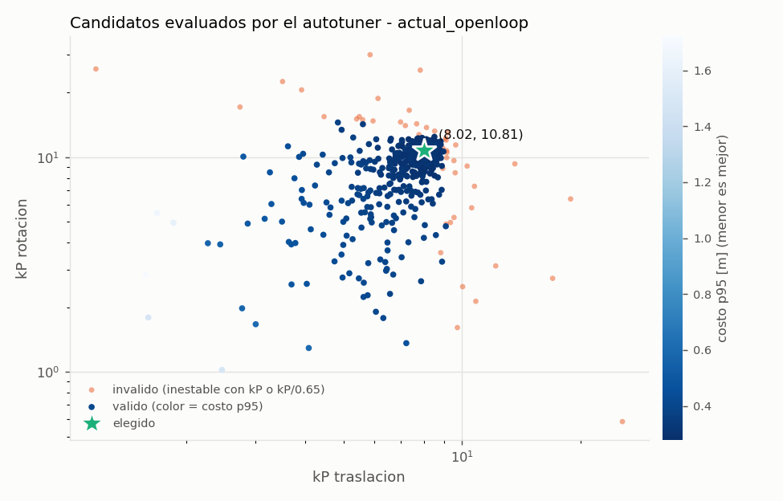
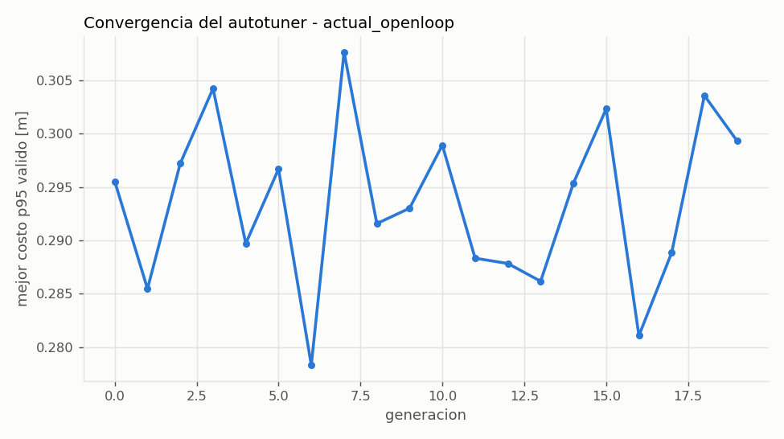
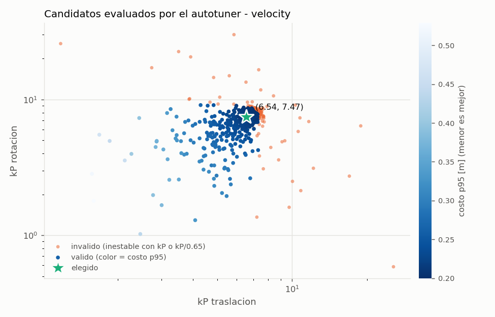
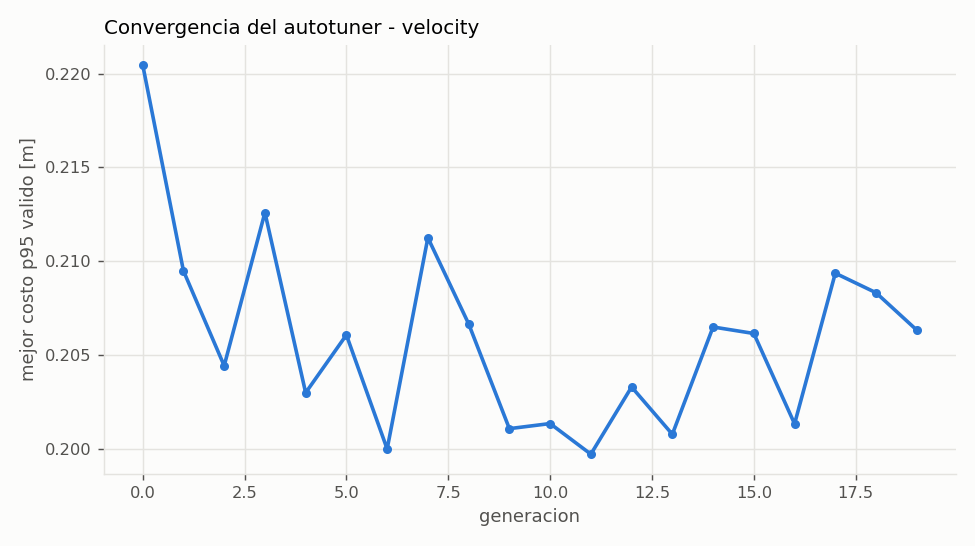
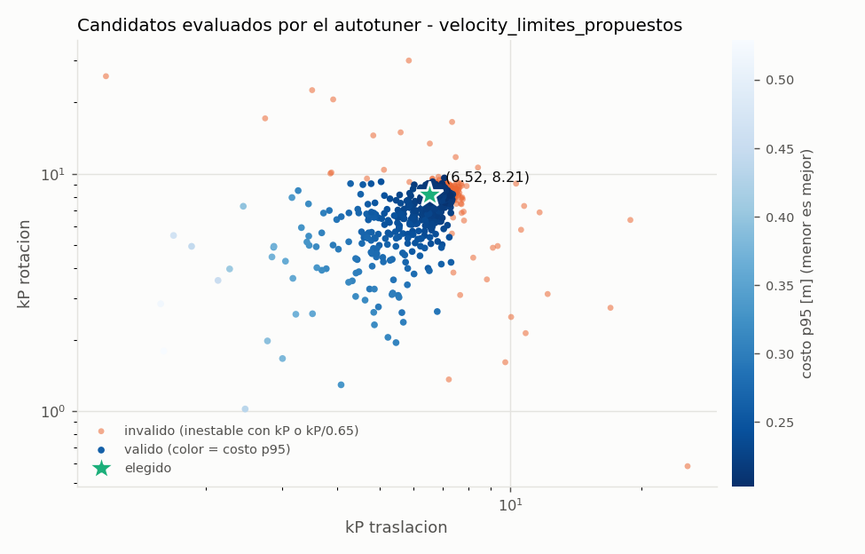
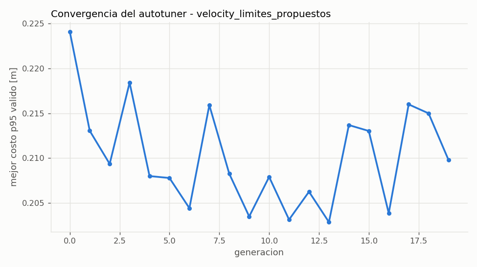

# Autotuning de kP de PathPlanner

Device `cuda`, 23.1 min en total. CEM: 20 generaciones x 48 candidatos x 192 robots, todas las trayectorias + mantener_pose, cada una con kP y con kP/0.65.

> Punto de partida, no valor final: confirmar en el robot real.

## Resultado

| variante | kP_t | kP_r | para el codigo (redondeado) | costo p95 [m] | inestables (kP) | inestables (kP/0.65) | corridas |
|---|---|---|---|---|---|---|---|
| actual_openloop | 8.02 | 10.81 | **(8, 10.5)** | 0.295 | 0 | 0 | 147456 |
| velocity | 6.54 | 7.47 | **(6.5, 7)** | 0.217 | 0 | 0 | 147456 |
| velocity_limites_propuestos | 6.52 | 8.21 | **(6.5, 8)** | 0.214 | 0 | 0 | 147456 |

- velocity: la busqueda llego a (6.88, 7.86), pero con 16384 robots nuevos aparecieron casos inestables; se bajo 5% 1 vez/veces hasta que ninguno fallo.
- velocity_limites_propuestos: la busqueda llego a (6.86, 8.64), pero con 16384 robots nuevos aparecieron casos inestables; se bajo 5% 1 vez/veces hasta que ninguno fallo.

Costo por corrida = error RMS de posicion + error final + (lo mismo en heading, 1 grado = 1 cm) + 1.0 m si aborta; se reporta el percentil 95 sobre robots y trayectorias.

## actual_openloop

### Validacion con robots nuevos

| candidato | kP | costo p95 / medio [m] | lateral RMS med / p95 / max [m] | error final pos med / p95 / max [m] | heading final p95 [deg] | inest. kP | inest. kP/0.65 | abortos |
|---|---|---|---|---|---|---|---|---|
| autotune | (8.02, 10.81) | 0.295 / 0.171 | 0.027 / 0.098 / 0.197 | 0.032 / 0.088 / 0.581 | 4.7 | 0 | 0 | 0 |
| autotune redondeado | (8.00, 10.50) | 0.295 / 0.172 | 0.027 / 0.099 / 0.197 | 0.032 / 0.089 / 0.576 | 5.1 | 0 | 0 | 0 |
| comparacion (5, 5) | (5.00, 5.00) | 0.415 / 0.250 | 0.035 / 0.129 / 0.181 | 0.058 / 0.117 / 0.294 | 12.5 | 0 | 0 | 0 |
| comparacion (10, 5) | (10.00, 5.00) | 0.387 / 0.186 | 0.025 / 0.077 / 0.174 | 0.028 / 0.059 / 0.405 | 13.0 | 0 | 2069 | 5 |

### Por trayectoria (p95) con el valor redondeado (8, 10.5)

| trayectoria | error RMS pos [m] | error final pos [m] | error final heading [deg] | inestables |
|---|---|---|---|---|
| mantener_pose | 0.044 | 0.004 | 0.1 | 0 |
| arco_90_giro90 | 0.092 | 0.043 | 0.1 | 0 |
| corto_1m | 0.115 | 0.125 | 0.7 | 0 |
| curva_s_lateral | 0.120 | 0.042 | 0.3 | 0 |
| diagonal_giro90 | 0.141 | 0.034 | 0.8 | 0 |
| giro_sitio_180 | 0.063 | 0.008 | 6.6 | 0 |
| lateral_2m | 0.110 | 0.058 | 0.1 | 0 |
| recta_4m | 0.102 | 0.042 | 0.1 | 0 |
| recta_6m_giro180 | 0.264 | 0.161 | 2.8 | 0 |

### Estres (fuera del rango aleatorizado, valor redondeado)

| escenario | costo p95 [m] | inestables | abortos | corridas |
|---|---|---|---|---|
| latencia_80ms | 0.801 | 0 | 386 | 36864 |
| cof_0.7 | 1.925 | 0 | 1923 | 36864 |
| velocidad_75pct | 1.894 | 0 | 4096 | 36864 |
| masa_mas_8kg | 0.317 | 0 | 0 | 36864 |
| cm_alto_0.30m | 0.334 | 0 | 0 | 36864 |
| error_inicial_30cm | 0.334 | 0 | 3 | 36864 |

### Finalistas re-evaluados juntos

| kP | costo p95 [m] | valido | inest. kP | inest. kP/0.65 |
|---|---|---|---|---|
| (8.02, 10.81) | 0.291 | si | 0 | 0 |
| (8.07, 10.57) | 0.291 | si | 0 | 0 |
| (7.82, 10.66) | 0.291 | si | 0 | 0 |
| (7.81, 10.17) | 0.292 | si | 0 | 0 |
| (7.91, 10.04) | 0.292 | si | 0 | 0 |
| (8.41, 11.43) | 0.292 | si | 0 | 0 |
| (7.94, 10.98) | 0.291 | no | 0 | 1 |
| (8.22, 12.00) | 0.292 | no | 0 | 4 |

## velocity

### Validacion con robots nuevos

| candidato | kP | costo p95 / medio [m] | lateral RMS med / p95 / max [m] | error final pos med / p95 / max [m] | heading final p95 [deg] | inest. kP | inest. kP/0.65 | abortos |
|---|---|---|---|---|---|---|---|---|
| autotune | (6.54, 7.47) | 0.212 / 0.133 | 0.026 / 0.095 / 0.152 | 0.039 / 0.047 / 0.097 | 6.0 | 0 | 0 | 0 |
| autotune redondeado | (6.50, 7.00) | 0.217 / 0.135 | 0.026 / 0.095 / 0.149 | 0.039 / 0.048 / 0.088 | 6.6 | 0 | 0 | 0 |
| comparacion (5, 5) | (5.00, 5.00) | 0.267 / 0.165 | 0.028 / 0.117 / 0.157 | 0.053 / 0.065 / 0.081 | 9.6 | 0 | 0 | 0 |
| comparacion (10, 5) | (10.00, 5.00) | 0.241 / 0.120 | 0.023 / 0.065 / 0.147 | 0.022 / 0.029 / 0.433 | 9.6 | 0 | 9457 | 0 |

### Por trayectoria (p95) con el valor redondeado (6.5, 7)

| trayectoria | error RMS pos [m] | error final pos [m] | error final heading [deg] | inestables |
|---|---|---|---|---|
| mantener_pose | 0.041 | 0.001 | 0.0 | 0 |
| arco_90_giro90 | 0.067 | 0.051 | 0.1 | 0 |
| corto_1m | 0.082 | 0.048 | 0.1 | 0 |
| curva_s_lateral | 0.081 | 0.044 | 0.1 | 0 |
| diagonal_giro90 | 0.107 | 0.047 | 0.1 | 0 |
| giro_sitio_180 | 0.059 | 0.001 | 7.2 | 0 |
| lateral_2m | 0.077 | 0.043 | 0.0 | 0 |
| recta_4m | 0.072 | 0.048 | 0.1 | 0 |
| recta_6m_giro180 | 0.158 | 0.047 | 0.2 | 0 |

### Estres (fuera del rango aleatorizado, valor redondeado)

| escenario | costo p95 [m] | inestables | abortos | corridas |
|---|---|---|---|---|
| latencia_80ms | 0.426 | 0 | 0 | 36864 |
| cof_0.7 | 0.921 | 0 | 52 | 36864 |
| velocidad_75pct | 0.376 | 0 | 0 | 36864 |
| masa_mas_8kg | 0.220 | 0 | 0 | 36864 |
| cm_alto_0.30m | 0.227 | 0 | 0 | 36864 |
| error_inicial_30cm | 0.262 | 0 | 0 | 36864 |

### Finalistas re-evaluados juntos

| kP | costo p95 [m] | valido | inest. kP | inest. kP/0.65 |
|---|---|---|---|---|
| (6.88, 7.86) | 0.205 | no | 0 | 1 |
| (6.85, 7.99) | 0.205 | no | 0 | 2 |
| (7.00, 7.72) | 0.206 | no | 0 | 3 |
| (6.91, 8.11) | 0.203 | no | 0 | 6 |
| (7.03, 8.12) | 0.202 | no | 0 | 11 |
| (7.08, 8.06) | 0.202 | no | 0 | 11 |
| (6.95, 8.42) | 0.201 | no | 0 | 16 |
| (6.89, 8.62) | 0.201 | no | 0 | 18 |

## velocity_limites_propuestos

### Validacion con robots nuevos

| candidato | kP | costo p95 / medio [m] | lateral RMS med / p95 / max [m] | error final pos med / p95 / max [m] | heading final p95 [deg] | inest. kP | inest. kP/0.65 | abortos |
|---|---|---|---|---|---|---|---|---|
| autotune | (6.52, 8.21) | 0.213 / 0.133 | 0.026 / 0.096 / 0.163 | 0.039 / 0.047 / 0.301 | 5.2 | 0 | 0 | 0 |
| autotune redondeado | (6.50, 8.00) | 0.214 / 0.133 | 0.026 / 0.096 / 0.162 | 0.039 / 0.047 / 0.276 | 5.5 | 0 | 0 | 0 |
| comparacion (5, 5) | (5.00, 5.00) | 0.268 / 0.166 | 0.028 / 0.117 / 0.158 | 0.053 / 0.065 / 0.109 | 9.6 | 0 | 0 | 0 |
| comparacion (10, 5) | (10.00, 5.00) | 0.262 / 0.131 | 0.023 / 0.067 / 0.419 | 0.022 / 0.030 / 1.286 | 9.7 | 0 | 8657 | 92 |

### Por trayectoria (p95) con el valor redondeado (6.5, 8)

| trayectoria | error RMS pos [m] | error final pos [m] | error final heading [deg] | inestables |
|---|---|---|---|---|
| mantener_pose | 0.042 | 0.001 | 0.1 | 0 |
| arco_90_giro90 | 0.071 | 0.048 | 0.1 | 0 |
| corto_1m | 0.088 | 0.049 | 0.1 | 0 |
| curva_s_lateral | 0.084 | 0.044 | 0.1 | 0 |
| diagonal_giro90 | 0.109 | 0.047 | 0.1 | 0 |
| giro_sitio_180 | 0.061 | 0.001 | 5.7 | 0 |
| lateral_2m | 0.081 | 0.043 | 0.0 | 0 |
| recta_4m | 0.075 | 0.048 | 0.1 | 0 |
| recta_6m_giro180 | 0.165 | 0.047 | 0.5 | 0 |

### Estres (fuera del rango aleatorizado, valor redondeado)

| escenario | costo p95 [m] | inestables | abortos | corridas |
|---|---|---|---|---|
| latencia_80ms | 0.597 | 0 | 28 | 36864 |
| cof_0.7 | 1.081 | 0 | 420 | 36864 |
| velocidad_75pct | 0.400 | 0 | 0 | 36864 |
| masa_mas_8kg | 0.222 | 0 | 0 | 36864 |
| cm_alto_0.30m | 0.242 | 0 | 0 | 36864 |
| error_inicial_30cm | 0.271 | 0 | 2 | 36864 |

### Finalistas re-evaluados juntos

| kP | costo p95 [m] | valido | inest. kP | inest. kP/0.65 |
|---|---|---|---|---|
| (6.86, 8.64) | 0.208 | no | 0 | 2 |
| (6.93, 8.50) | 0.208 | no | 0 | 2 |
| (7.10, 8.27) | 0.208 | no | 0 | 3 |
| (7.12, 8.37) | 0.207 | no | 0 | 4 |
| (6.93, 8.91) | 0.207 | no | 0 | 6 |
| (7.19, 8.06) | 0.209 | no | 0 | 8 |
| (7.20, 8.13) | 0.208 | no | 0 | 9 |
| (6.98, 9.03) | 0.206 | no | 0 | 10 |

