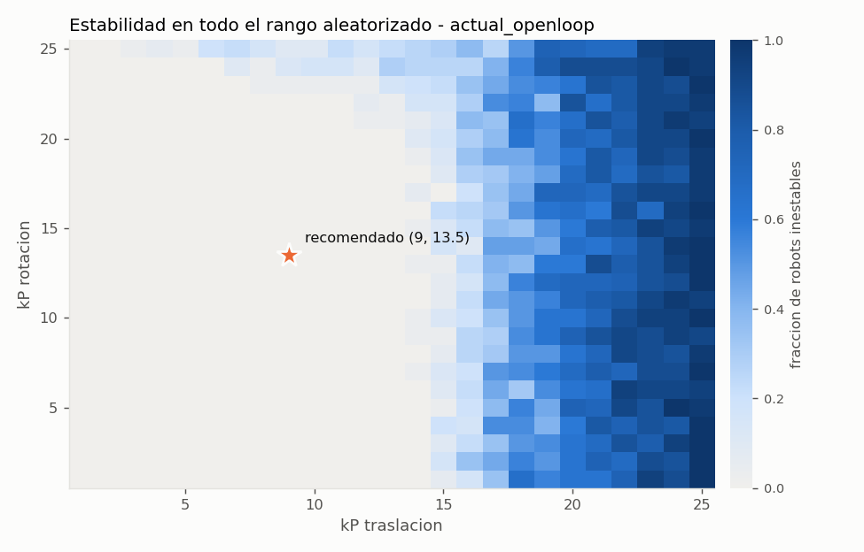
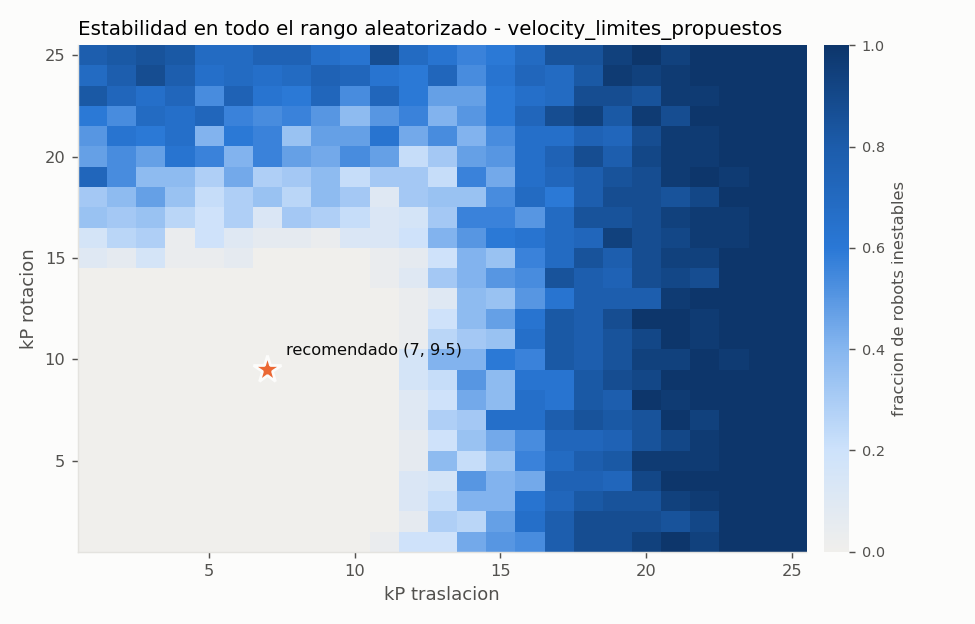
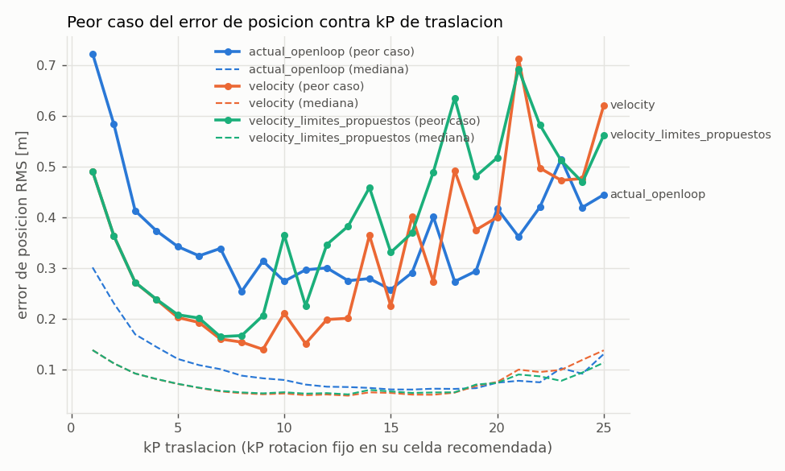
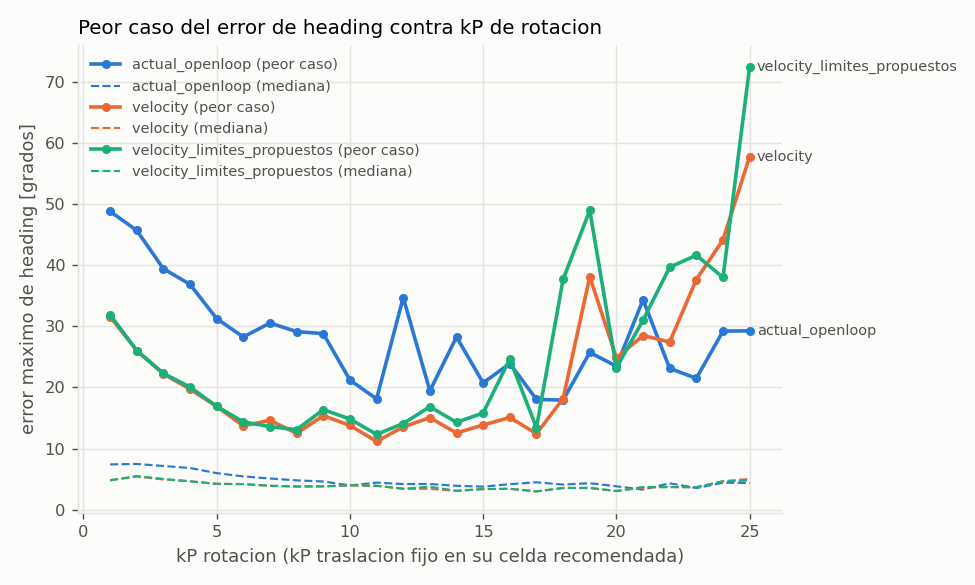

# Sweep de PID para PathPlanner - resumen

Generado 2026-10-12 06:00 con backend `torch-cuda`. 20000 robots aleatorizados por variante, trayectorias: arco_90_giro90, corto_1m, curva_s_lateral, diagonal_giro90, giro_sitio_180, lateral_2m, mantener_pose, recta_4m, recta_6m_giro180.

> Estos kP son un **punto de partida**. El modelo es una simplificacion: hay que confirmarlos en el robot real, empezando por el valor recomendado y subiendo con cuidado.

## Recomendacion por variante

Regla: kP = 65% del limite de inestabilidad **robusto** (el kP mas bajo que se volvio inestable en CUALQUIER robot del rango aleatorizado), redondeado hacia abajo a 0.5.

| variante | limite kP_t | kP_t recomendado | limite kP_r | kP_r recomendado | celda evaluada (t, r) |
|---|---|---|---|---|---|
| actual_openloop | 14.0 | 9.0 | 21.0 | 13.5 | (9, 13) |
| velocity | 11.0 | 7.0 | 15.0 | 9.5 | (7, 9) |
| velocity_limites_propuestos | 11.0 | 7.0 | 15.0 | 9.5 | (7, 9) |

- **actual_openloop**: 2666 robots fueron inestables en traslacion Y rotacion a la vez (acoplamiento). Cuentan para el limite de un eje solo si la ganancia del otro eje esta por debajo de su propio limite.
- **velocity**: 4392 robots fueron inestables en traslacion Y rotacion a la vez (acoplamiento). Cuentan para el limite de un eje solo si la ganancia del otro eje esta por debajo de su propio limite.
- **velocity_limites_propuestos**: 3540 robots fueron inestables en traslacion Y rotacion a la vez (acoplamiento). Cuentan para el limite de un eje solo si la ganancia del otro eje esta por debajo de su propio limite.

## Metricas en la celda recomendada (mediana / peor caso, sobre robots y trayectorias)

| variante | error lateral RMS [m] | error final pos [m] | error final heading [deg] | sobreimpulso [m] | tiempo total [s] | derrape | abortos | inestables |
|---|---|---|---|---|---|---|---|---|
| actual_openloop | 0.024 / 0.181 | 0.030 / 0.545 | 0.1 / 10.5 | 0.031 / 0.485 | 1.86 / 2.76 | 31% / 73% | 0/256 | 0/256 |
| velocity | 0.025 / 0.118 | 0.036 / 0.045 | 0.0 / 4.8 | 0.042 / 0.079 | 1.86 / 2.54 | 26% / 68% | 0/256 | 0/256 |
| velocity_limites_propuestos | 0.026 / 0.119 | 0.036 / 0.090 | 0.0 / 4.8 | 0.042 / 0.139 | 1.86 / 2.60 | 27% / 82% | 0/256 | 0/256 |

### Por trayectoria - actual_openloop en (9, 13)

| trayectoria | lateral RMS med/peor [m] | final pos med/peor [m] | final heading peor [deg] | abortos |
|---|---|---|---|---|
| arco_90_giro90 | 0.018 / 0.039 | 0.029 / 0.037 | 0.3 | 0/32 |
| corto_1m | 0.021 / 0.051 | 0.070 / 0.221 | 1.6 | 0/32 |
| curva_s_lateral | 0.030 / 0.051 | 0.031 / 0.050 | 3.4 | 0/32 |
| diagonal_giro90 | 0.049 / 0.133 | 0.029 / 0.096 | 3.9 | 0/32 |
| giro_sitio_180 | 0.000 / 0.000 | 0.002 / 0.015 | 4.1 | 0/32 |
| lateral_2m | 0.023 / 0.037 | 0.028 / 0.048 | 0.5 | 0/32 |
| recta_4m | 0.015 / 0.035 | 0.034 / 0.051 | 0.2 | 0/32 |
| recta_6m_giro180 | 0.089 / 0.181 | 0.023 / 0.545 | 10.5 | 0/32 |

## Primer caso inestable (que robot fijo el limite)

- actual_openloop, traslacion: kP=(14, 7) en `mantener_pose`, latencia 59 ms, COF 1.11, velocidad 100%, MOI 7.00 (7 robots en ese kP)
- actual_openloop, rotacion: kP=(12, 21) en `mantener_pose`, latencia 57 ms, COF 1.38, velocidad 97%, MOI 7.06 (2 robots en ese kP)
- velocity, traslacion: kP=(11, 1) en `mantener_pose`, latencia 60 ms, COF 1.01, velocidad 99%, MOI 6.83 (1 robots en ese kP)
- velocity, rotacion: kP=(1, 15) en `mantener_pose`, latencia 60 ms, COF 1.53, velocidad 99%, MOI 7.34 (19 robots en ese kP)
- velocity_limites_propuestos, traslacion: kP=(11, 1) en `mantener_pose`, latencia 60 ms, COF 1.01, velocidad 99%, MOI 6.83 (1 robots en ese kP)
- velocity_limites_propuestos, rotacion: kP=(1, 15) en `mantener_pose`, latencia 60 ms, COF 1.53, velocidad 99%, MOI 7.34 (14 robots en ese kP)

Si el limite lo fija casi siempre la latencia alta, medir la latencia real del robot es lo que mas mueve la recomendacion.

## Informativo: celda sin inestabilidad con mejor peor caso de error RMS

- actual_openloop: kP=(10, 1), peor RMS de posicion 0.153 m
- velocity: kP=(10, 1), peor RMS de posicion 0.095 m
- velocity_limites_propuestos: kP=(9, 2), peor RMS de posicion 0.117 m

Si esta celda queda muy por debajo de la recomendada, kP mas alto no esta ayudando (la latencia o la traccion limitan antes que la ganancia).

## Graficas

## Como leer las metricas

- **error lateral RMS**: distancia perpendicular a la direccion de avance del path, durante el path.
- **error final**: pose del centro del robot contra la pose final del path, despues de detenerse (PathPlanner manda velocidad 0 al terminar y ya no corrige).
- **sobreimpulso**: cuanto se pasa del punto final en la direccion de llegada (m) o del heading final (deg).
- **tiempo total**: hasta que el robot queda quieto (< 0.05 m/s); `nan` si no se detuvo en el tiempo simulado.
- **derrape**: fraccion del tiempo del path con algun modulo en el limite de friccion.
- **aborto**: error > 0.75 m o > 30 grados.
- **inestable**: aborto, o en la prueba `mantener_pose` mas de 2 inversiones del error o falta de convergencia.

## Rangos aleatorizados

masa extra [0.0, 0.0] kg, MOI [6.6, 7.4] kg m2, altura CM [0.19, 0.21] m, COF [0.9, 1.6], velocidad real [0.85, 1.0] x 5.85 m/s, latencia [0.02, 0.06] s, error inicial <= 0.15 m / 5.0 deg.

## Supuestos y limitaciones del modelo

- Cuerpo rigido plano; sin suspension, sin cabeceo/balanceo (la transferencia de carga es cuasi-estatica).
- La pose medida es la real (sin ruido, sin deriva de odometria por derrape); la latencia es un retraso puro del comando.
- Sin modelo de bateria: 12 V fijos. La caida de voltaje se representa solo via `speed_factor`.
- `speed_factor` se modela bajando Kv del motor; en la realidad parte es friccion (kS) y bateria.
- Steer: limite de velocidad + primer orden con valores supuestos (TODO medir).
- Llanta: modelo lineal de angulo de deslizamiento + circulo de friccion; sin datos del Spike Grip.
- Los feedforwards de fuerza de PathPlanner se ignoran (igual que el codigo actual del robot).
- Trayectorias sinteticas, no las de PathPlanner (no hay paths en el proyecto). PathPlanner limita con un modelo de fuerzas por modulo; aqui se limita aceleracion tangencial y centripeta por separado.
- kI = kD = 0, como pediste.
