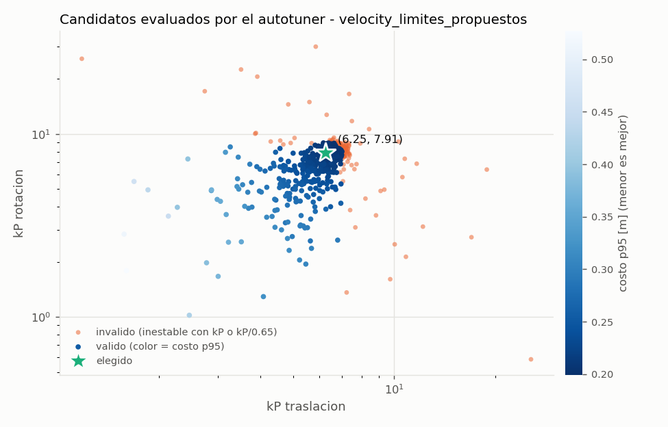
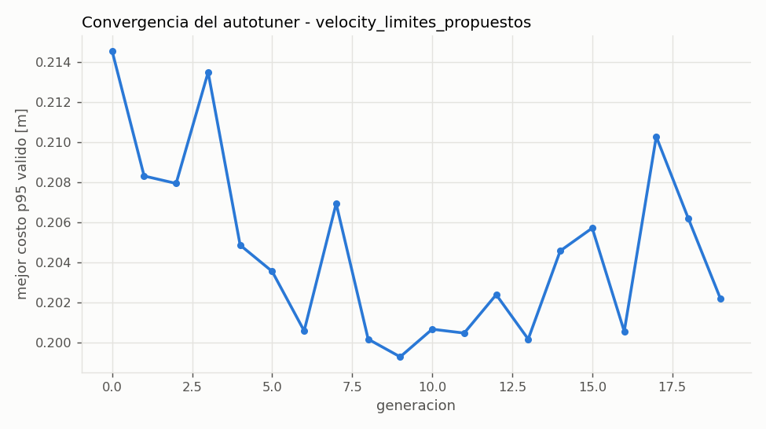

# Autotuning de kP de PathPlanner

Device `cuda`, 5.1 min en total. CEM: 20 generaciones x 48 candidatos x 192 robots, todas las trayectorias + mantener_pose, cada una con kP y con kP/0.65.

> Punto de partida, no valor final: confirmar en el robot real.

## Resultado

| variante | kP_t | kP_r | para el codigo (redondeado) | costo p95 [m] | inestables (kP) | inestables (kP/0.65) | corridas |
|---|---|---|---|---|---|---|---|
| velocity_limites_propuestos | 6.25 | 7.91 | **(6, 7.5)** | 0.214 | 0 | 0 | 147456 |

- velocity_limites_propuestos: la busqueda llego a (6.58, 8.33), pero con 16384 robots nuevos aparecieron casos inestables; se bajo 5% 1 vez/veces hasta que ninguno fallo.

Costo por corrida = error RMS de posicion + error final + (lo mismo en heading, 1 grado = 1 cm) + 1.0 m si aborta; se reporta el percentil 95 sobre robots y trayectorias.

## velocity_limites_propuestos

### Validacion con robots nuevos

| candidato | kP | costo p95 / medio [m] | lateral RMS med / p95 / max [m] | error final pos med / p95 / max [m] | heading final p95 [deg] | inest. kP | inest. kP/0.65 | abortos |
|---|---|---|---|---|---|---|---|---|
| autotune | (6.25, 7.91) | 0.208 / 0.135 | 0.026 / 0.099 / 0.140 | 0.042 / 0.050 / 0.201 | 5.5 | 0 | 0 | 0 |
| autotune redondeado | (6.00, 7.50) | 0.214 / 0.139 | 0.027 / 0.102 / 0.143 | 0.044 / 0.053 / 0.170 | 6.0 | 0 | 0 | 0 |
| comparacion (5, 5) | (5.00, 5.00) | 0.263 / 0.165 | 0.028 / 0.118 / 0.159 | 0.054 / 0.066 / 0.105 | 9.8 | 0 | 0 | 0 |
| comparacion (10, 5) | (10.00, 5.00) | 0.253 / 0.127 | 0.023 / 0.066 / 0.455 | 0.022 / 0.029 / 1.060 | 9.9 | 1 | 10760 | 50 |

### Por trayectoria (p95) con el valor redondeado (6, 7.5)

| trayectoria | error RMS pos [m] | error final pos [m] | error final heading [deg] | inestables |
|---|---|---|---|---|
| mantener_pose | 0.042 | 0.001 | 0.1 | 0 |
| arco_90_giro90 | 0.071 | 0.057 | 0.5 | 0 |
| corto_1m | 0.086 | 0.055 | 0.1 | 0 |
| curva_s_lateral | 0.086 | 0.049 | 0.1 | 0 |
| diagonal_giro90 | 0.114 | 0.051 | 0.1 | 0 |
| giro_sitio_180 | 0.061 | 0.001 | 6.3 | 0 |
| lateral_2m | 0.081 | 0.048 | 0.0 | 0 |
| recta_4m | 0.076 | 0.053 | 0.1 | 0 |
| recta_6m_giro180 | 0.161 | 0.051 | 0.2 | 0 |

### Estres (fuera del rango aleatorizado, valor redondeado)

| escenario | costo p95 [m] | inestables | abortos | corridas |
|---|---|---|---|---|
| latencia_80ms | 0.604 | 0 | 1 | 36864 |
| cof_0.7 | 0.972 | 0 | 102 | 36864 |
| velocidad_75pct | 0.468 | 0 | 0 | 36864 |
| masa_mas_8kg | 0.220 | 0 | 0 | 36864 |
| cm_alto_0.30m | 0.236 | 0 | 0 | 36864 |
| error_inicial_30cm | 0.263 | 0 | 0 | 36864 |

### Finalistas re-evaluados juntos

| kP | costo p95 [m] | valido | inest. kP | inest. kP/0.65 |
|---|---|---|---|---|
| (6.58, 8.33) | 0.202 | si | 0 | 0 |
| (6.69, 8.04) | 0.203 | no | 0 | 1 |
| (6.76, 7.90) | 0.204 | no | 0 | 1 |
| (6.67, 8.41) | 0.201 | no | 0 | 2 |
| (6.77, 8.12) | 0.202 | no | 0 | 2 |
| (6.73, 8.26) | 0.201 | no | 0 | 3 |
| (6.51, 8.83) | 0.201 | no | 0 | 5 |
| (6.63, 8.90) | 0.199 | no | 0 | 14 |

