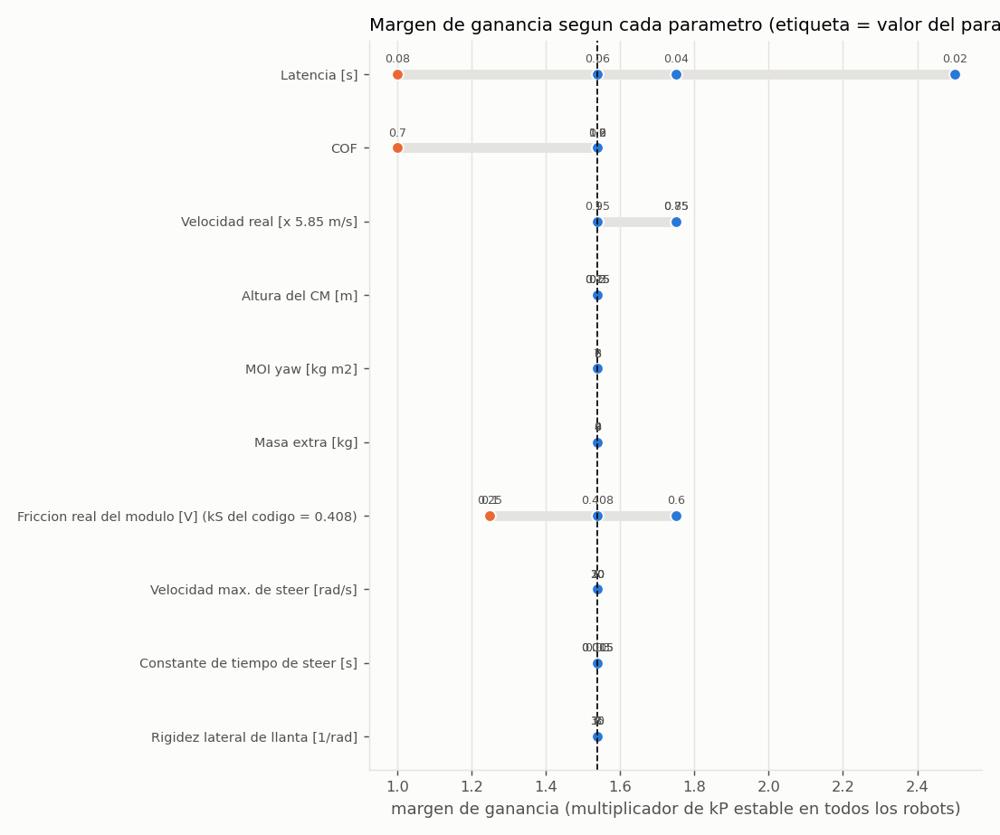

# Sensibilidad de kP = (6.5, 8) - velocity_limites_propuestos

1024 robots por punto x 7 multiplicadores x 9 pruebas; 9.1 min en `cuda`. Margen = mayor multiplicador de kP estable en TODOS los robots (probados: 1, 1.25, 1.54, 1.75, 2, 2.5, 3). La regla del 65% pide >= 1.54.

Nominal (todo aleatorizado en el rango normal): margen x1.54, costo p95 0.213 m.

| parametro | valor | margen de ganancia | cumple 65% | costo p95 [m] | abortos |
|---|---|---|---|---|---|
| Latencia [s] | 0.02 | x2.5 | si | 0.150 | 0/8192 |
| Latencia [s] | 0.04 | x1.75 | si | 0.201 | 0/8192 |
| Latencia [s] | 0.06 | x1.54 | si | 0.273 | 0/8192 |
| Latencia [s] | 0.08 | x1 | **no** | 0.605 | 13/8192 |
| COF | 0.7 | x1 | **no** | 1.072 | 88/8192 |
| COF | 0.9 | x1.54 | si | 0.246 | 0/8192 |
| COF | 1.2 | x1.54 | si | 0.211 | 0/8192 |
| COF | 1.6 | x1.54 | si | 0.205 | 0/8192 |
| Velocidad real [x 5.85 m/s] | 0.75 | x1.75 | si | 0.400 | 0/8192 |
| Velocidad real [x 5.85 m/s] | 0.85 | x1.75 | si | 0.248 | 0/8192 |
| Velocidad real [x 5.85 m/s] | 0.95 | x1.54 | si | 0.204 | 0/8192 |
| Velocidad real [x 5.85 m/s] | 1 | x1.54 | si | 0.200 | 0/8192 |
| Altura del CM [m] | 0.15 | x1.54 | si | 0.207 | 0/8192 |
| Altura del CM [m] | 0.2 | x1.54 | si | 0.213 | 0/8192 |
| Altura del CM [m] | 0.25 | x1.54 | si | 0.222 | 0/8192 |
| Altura del CM [m] | 0.3 | x1.54 | si | 0.238 | 0/8192 |
| MOI yaw [kg m2] | 6 | x1.54 | si | 0.208 | 0/8192 |
| MOI yaw [kg m2] | 7 | x1.54 | si | 0.213 | 0/8192 |
| MOI yaw [kg m2] | 8 | x1.54 | si | 0.220 | 0/8192 |
| Masa extra [kg] | 0 | x1.54 | si | 0.213 | 0/8192 |
| Masa extra [kg] | 4 | x1.54 | si | 0.215 | 0/8192 |
| Masa extra [kg] | 8 | x1.54 | si | 0.218 | 0/8192 |
| Friccion real del modulo [V] (kS del codigo = 0.408) | 0.1 | x1.25 | **no** | 0.214 | 0/8192 |
| Friccion real del modulo [V] (kS del codigo = 0.408) | 0.25 | x1.25 | **no** | 0.213 | 0/8192 |
| Friccion real del modulo [V] (kS del codigo = 0.408) | 0.408 | x1.54 | si | 0.213 | 0/8192 |
| Friccion real del modulo [V] (kS del codigo = 0.408) | 0.6 | x1.75 | si | 0.213 | 0/8192 |
| Velocidad max. de steer [rad/s] | 10 | x1.54 | si | 0.254 | 7/8192 |
| Velocidad max. de steer [rad/s] | 20 | x1.54 | si | 0.213 | 0/8192 |
| Velocidad max. de steer [rad/s] | 30 | x1.54 | si | 0.211 | 0/8192 |
| Constante de tiempo de steer [s] | 0.005 | x1.54 | si | 0.201 | 0/8192 |
| Constante de tiempo de steer [s] | 0.015 | x1.54 | si | 0.213 | 0/8192 |
| Constante de tiempo de steer [s] | 0.03 | x1.54 | si | 0.244 | 0/8192 |
| Rigidez lateral de llanta [1/rad] | 8 | x1.54 | si | 0.220 | 0/8192 |
| Rigidez lateral de llanta [1/rad] | 15 | x1.54 | si | 0.213 | 0/8192 |
| Rigidez lateral de llanta [1/rad] | 30 | x1.54 | si | 0.208 | 0/8192 |

## Que medir primero (lo que mas mueve el margen)

- Latencia [s]: margen entre x1 y x2.5
- COF: margen entre x1 y x1.54
- Friccion real del modulo [V] (kS del codigo = 0.408): margen entre x1.25 y x1.75
- Velocidad real [x 5.85 m/s]: margen entre x1.54 y x1.75
- Altura del CM [m]: margen entre x1.54 y x1.54
- MOI yaw [kg m2]: margen entre x1.54 y x1.54
- Masa extra [kg]: margen entre x1.54 y x1.54
- Velocidad max. de steer [rad/s]: margen entre x1.54 y x1.54
- Constante de tiempo de steer [s]: margen entre x1.54 y x1.54
- Rigidez lateral de llanta [1/rad]: margen entre x1.54 y x1.54

