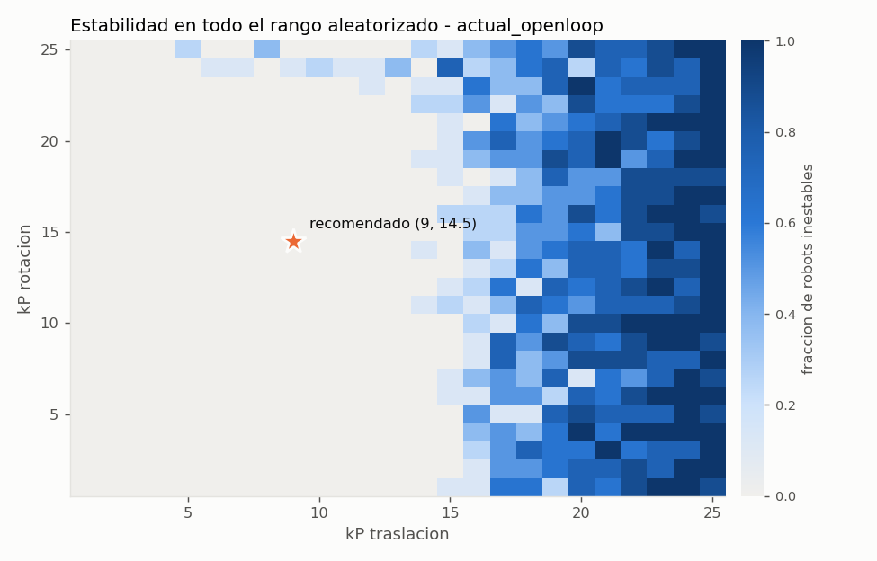
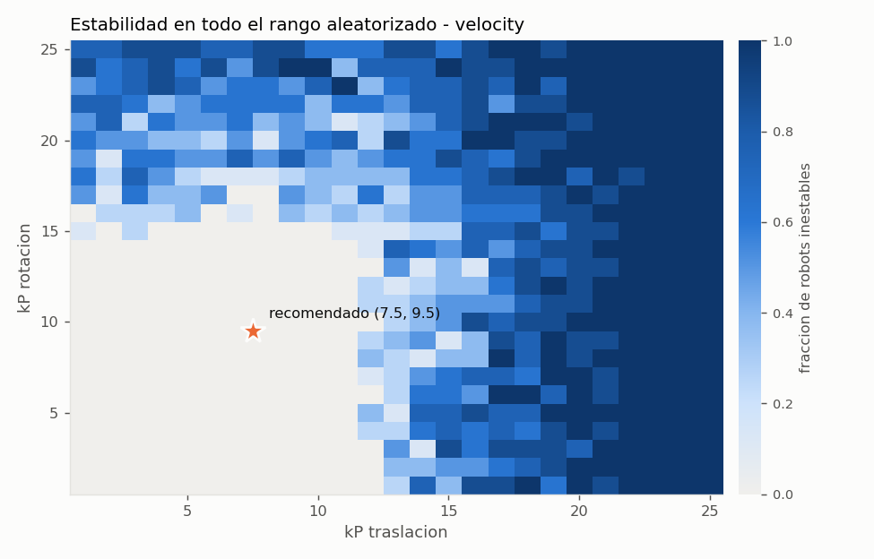
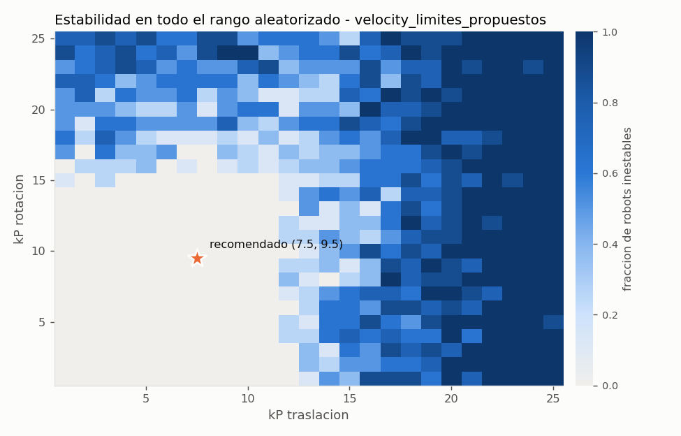
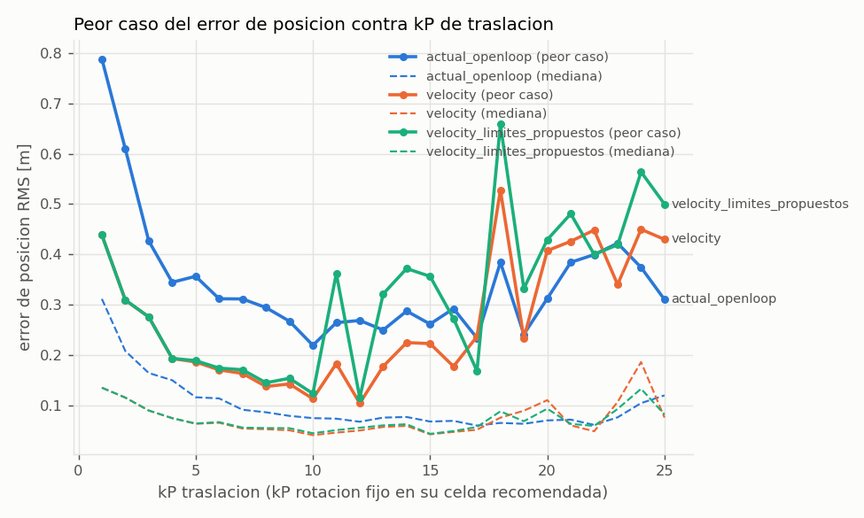
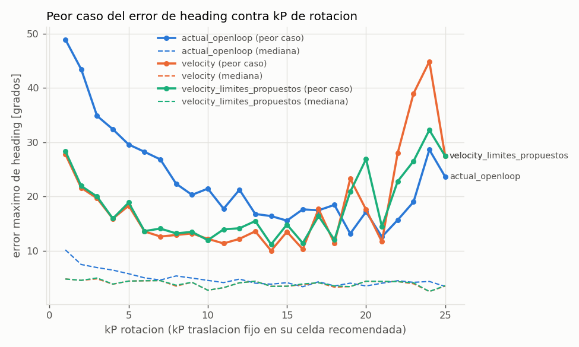

# Sweep de PID para PathPlanner - resumen

Generado 2026-10-12 05:01 con backend `csv`. 5000 robots aleatorizados por variante, trayectorias: arco_90_giro90, corto_1m, curva_s_lateral, diagonal_giro90, giro_sitio_180, lateral_2m, mantener_pose, recta_4m, recta_6m_giro180.

> Estos kP son un **punto de partida**. El modelo es una simplificacion: hay que confirmarlos en el robot real, empezando por el valor recomendado y subiendo con cuidado.

## Recomendacion por variante

Regla: kP = 65% del limite de inestabilidad **robusto** (el kP mas bajo que se volvio inestable en CUALQUIER robot del rango aleatorizado), redondeado hacia abajo a 0.5.

| variante | limite kP_t | kP_t recomendado | limite kP_r | kP_r recomendado | celda evaluada (t, r) |
|---|---|---|---|---|---|
| actual_openloop | 14.0 | 9.0 | 23.0 | 14.5 | (9, 14) |
| velocity | 12.0 | 7.5 | 15.0 | 9.5 | (7, 9) |
| velocity_limites_propuestos | 12.0 | 7.5 | 15.0 | 9.5 | (7, 9) |

- **actual_openloop**: 663 robots fueron inestables en traslacion Y rotacion a la vez (acoplamiento). Cuentan para el limite de un eje solo si la ganancia del otro eje esta por debajo de su propio limite.
- **velocity**: 1084 robots fueron inestables en traslacion Y rotacion a la vez (acoplamiento). Cuentan para el limite de un eje solo si la ganancia del otro eje esta por debajo de su propio limite.
- **velocity_limites_propuestos**: 875 robots fueron inestables en traslacion Y rotacion a la vez (acoplamiento). Cuentan para el limite de un eje solo si la ganancia del otro eje esta por debajo de su propio limite.

## Metricas en la celda recomendada (mediana / peor caso, sobre robots y trayectorias)

| variante | error lateral RMS [m] | error final pos [m] | error final heading [deg] | sobreimpulso [m] | tiempo total [s] | derrape | abortos | inestables |
|---|---|---|---|---|---|---|---|---|
| actual_openloop | 0.027 / 0.123 | 0.029 / 0.143 | 0.1 / 2.5 | 0.029 / 0.269 | 1.86 / 2.68 | 31% / 75% | 0/64 | 0/64 |
| velocity | 0.024 / 0.114 | 0.033 / 0.043 | 0.0 / 4.7 | 0.036 / 0.061 | 1.86 / 2.48 | 26% / 64% | 0/64 | 0/64 |
| velocity_limites_propuestos | 0.024 / 0.116 | 0.033 / 0.044 | 0.0 / 4.8 | 0.036 / 0.060 | 1.86 / 2.54 | 27% / 64% | 0/64 | 0/64 |

### Por trayectoria - actual_openloop en (9, 14)

| trayectoria | lateral RMS med/peor [m] | final pos med/peor [m] | final heading peor [deg] | abortos |
|---|---|---|---|---|
| arco_90_giro90 | 0.024 / 0.040 | 0.028 / 0.033 | 0.1 | 0/8 |
| corto_1m | 0.032 / 0.052 | 0.066 / 0.084 | 0.3 | 0/8 |
| curva_s_lateral | 0.029 / 0.043 | 0.033 / 0.044 | 0.1 | 0/8 |
| diagonal_giro90 | 0.044 / 0.062 | 0.030 / 0.036 | 0.2 | 0/8 |
| giro_sitio_180 | 0.000 / 0.000 | 0.001 / 0.008 | 2.0 | 0/8 |
| lateral_2m | 0.016 / 0.032 | 0.027 / 0.032 | 0.0 | 0/8 |
| recta_4m | 0.022 / 0.036 | 0.034 / 0.044 | 0.1 | 0/8 |
| recta_6m_giro180 | 0.076 / 0.123 | 0.031 / 0.143 | 2.5 | 0/8 |

## Primer caso inestable (que robot fijo el limite)

- actual_openloop, traslacion: kP=(14, 11) en `mantener_pose`, latencia 59 ms, COF 0.98, velocidad 99%, MOI 6.87 (3 robots en ese kP)
- actual_openloop, rotacion: kP=(12, 23) en `mantener_pose`, latencia 59 ms, COF 1.32, velocidad 96%, MOI 6.67 (1 robots en ese kP)
- velocity, traslacion: kP=(12, 4) en `mantener_pose`, latencia 57 ms, COF 1.10, velocidad 100%, MOI 6.85 (15 robots en ese kP)
- velocity, rotacion: kP=(1, 15) en `mantener_pose`, latencia 60 ms, COF 1.12, velocidad 97%, MOI 6.91 (4 robots en ese kP)
- velocity_limites_propuestos, traslacion: kP=(12, 4) en `mantener_pose`, latencia 57 ms, COF 1.10, velocidad 100%, MOI 6.85 (15 robots en ese kP)
- velocity_limites_propuestos, rotacion: kP=(1, 15) en `mantener_pose`, latencia 60 ms, COF 1.12, velocidad 97%, MOI 6.91 (3 robots en ese kP)

Si el limite lo fija casi siempre la latencia alta, medir la latencia real del robot es lo que mas mueve la recomendacion.

## Informativo: celda sin inestabilidad con mejor peor caso de error RMS

- actual_openloop: kP=(12, 1), peor RMS de posicion 0.123 m
- velocity: kP=(11, 1), peor RMS de posicion 0.074 m
- velocity_limites_propuestos: kP=(11, 2), peor RMS de posicion 0.083 m

Si esta celda queda muy por debajo de la recomendada, kP mas alto no esta ayudando (la latencia o la traccion limitan antes que la ganancia).

## Graficas

## Como leer las metricas

- **error lateral RMS**: distancia perpendicular a la direccion de avance del path, durante el path.
- **error final**: pose del centro del robot contra la pose final del path, despues de detenerse (PathPlanner manda velocidad 0 al terminar y ya no corrige).
- **sobreimpulso**: cuanto se pasa del punto final en la direccion de llegada (m) o del heading final (deg).
- **tiempo total**: hasta que el robot queda quieto (< 0.05 m/s); `nan` si no se detuvo en el tiempo simulado.
- **derrape**: fraccion del tiempo del path con algun modulo en el limite de friccion.
- **aborto**: error > 0.75 m o > 30 grados.
- **inestable**: aborto, o en la prueba `mantener_pose` mas de 2 inversiones del error o falta de convergencia.

## Rangos aleatorizados

masa extra [0.0, 0.0] kg, MOI [6.6, 7.4] kg m2, altura CM [0.19, 0.21] m, COF [0.9, 1.6], velocidad real [0.85, 1.0] x 5.85 m/s, latencia [0.02, 0.06] s, error inicial <= 0.15 m / 5.0 deg.

## Supuestos y limitaciones del modelo

- Cuerpo rigido plano; sin suspension, sin cabeceo/balanceo (la transferencia de carga es cuasi-estatica).
- La pose medida es la real (sin ruido, sin deriva de odometria por derrape); la latencia es un retraso puro del comando.
- Sin modelo de bateria: 12 V fijos. La caida de voltaje se representa solo via `speed_factor`.
- `speed_factor` se modela bajando Kv del motor; en la realidad parte es friccion (kS) y bateria.
- Steer: limite de velocidad + primer orden con valores supuestos (TODO medir).
- Llanta: modelo lineal de angulo de deslizamiento + circulo de friccion; sin datos del Spike Grip.
- Los feedforwards de fuerza de PathPlanner se ignoran (igual que el codigo actual del robot).
- Trayectorias sinteticas, no las de PathPlanner (no hay paths en el proyecto). PathPlanner limita con un modelo de fuerzas por modulo; aqui se limita aceleracion tangencial y centripeta por separado.
- kI = kD = 0, como pediste.
